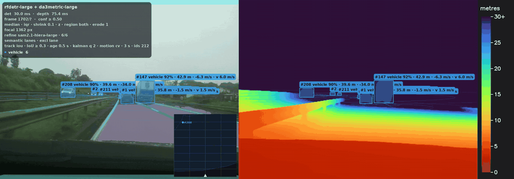
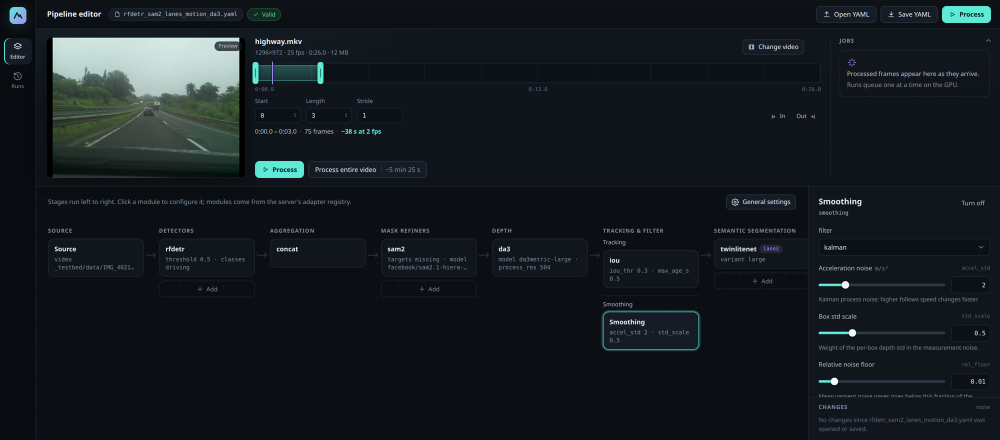

<div align="center">

# av-perception-lab

**A perception test bed for autonomous driving: pluggable detectors, metric depth and tracking, with per-object distance.**

[](https://github.com/bfMendonca/av-perception-lab/actions/workflows/ci.yml)
[](pyproject.toml)
[](LICENSE)
[](https://github.com/astral-sh/ruff)
[](https://github.com/astral-sh/uv)
<br>
[](https://github.com/roboflow/rf-detr)
[](https://github.com/ultralytics/ultralytics)
[](https://github.com/ByteDance-Seed/Depth-Anything-3)
[](https://github.com/facebookresearch/sam2)
[](docs/reference.md#entrada-mcap-ros-2)
<br>
[](https://github.com/bfMendonca/av-perception-lab)
[](https://github.com/bfMendonca/av-perception-lab/network/members)
[](https://github.com/bfMendonca/av-perception-lab/commits/main)

[Features](#features) ·
[Demo](#demo) ·
[Requirements](#requirements) ·
[How it works](#how-it-works) ·
[Quick start](#quick-start) ·
[Documentation](#documentation) ·
[Contributing](CONTRIBUTING.md)

<br>



<sub>Six seconds of a highway recording, processed with RF-DETR, SAM 2.1, TwinLiteNet+ and Depth Anything 3 (<code>configs/rfdetr_sam2_lanes_motion_da3.yaml</code>). Left: the annotated frame with the distance and relative speed of each tracked vehicle, and a bird's-eye view in the corner. Right: the metric depth map.</sub>

</div>

---

A research prototype for studying how detection, depth, segmentation and tracking models chain into a perception stack, using only open-source models. Every stage is a plug-in component that you pick in a YAML file or in the web interface. For each detected object it reports the distance with an uncertainty; for tracked objects it also reports the relative speed and a predicted trajectory.

What a run writes to its output folder:

- `video.mp4`: the input with boxes, masks and a distance label on every object.
- `detections.csv`: one row per detection with box, class, score and distance statistics (61 columns).
- `metrics.json`: the pipeline that ran, the camera used, timings and distance summaries.
- `trajectories.jsonl` (with the motion stage) and `depth.npz` (with `output.save_depth`).

## Features

- **Pluggable stages.** Detectors (RF-DETR, YOLO26), mask refiners (SAM 2.1, SAM, SAM-HQ, EdgeTAM, SAM 3 tracker, MobileSAM) and semantic segmenters (SegFormer, TwinLiteNet+) are registered classes; a new model is a new class plus its weights recipe ([`docs/model_environments.md`](docs/model_environments.md)).
- **Metric distance from one camera.** Depth Anything 3 metric depth is converted to meters with the focal length and read from the box or from the instance mask (`distance.region`, `distance.mask_erode`).
- **Several detectors in one run.** `concat`, `nms` and `wbf` aggregators merge them, with label maps per vocabulary in [`configs/labels/`](configs/labels).
- **Tracking and smoothing.** An IoU tracker gives each object an id; per-track smoothing (`kalman`, `ema` or `median`) gives a distance with an uncertainty and, with Kalman, the relative speed.
- **Motion on the road plane.** The `cv` and `ctrv` models estimate position, speed, heading and turn rate per track and predict a trajectory; an optional ego-motion provider reads a CSV.
- **Camera handling.** Calibration with a chessboard or ChArUco board (`av-perception-lab-calibrate`), lens check, undistortion, or a focal length estimated by Depth Anything 3.
- **ROS 2 MCAP input.** Reads an `Image` or `CompressedImage` topic directly, takes the camera intrinsics from its `CameraInfo`, and offers an optional rectification stage.
- **Web interface.** Edit the pipeline, prepare model weights, save presets, process a segment of a video or MCAP, and compare runs.
- **Evaluation.** `av-perception-lab-evaluate` compares the distances with field references and reports the error.

## Demo

<div align="center">

</div>

A few rows of `detections.csv` from a real run with the detector and depth settings of `configs/rfdetr_da3.yaml` (RF-DETR large and Depth Anything 3 metric on a 1296x972 recording; most of the 61 columns left out):

```csv
frame,t,class_name,confidence,distance_m
2625,105.0,car,0.93,17.6
2625,105.0,car,0.84,50.4
2625,105.0,car,0.54,79.9
2626,105.04,car,0.93,17.5
2626,105.04,car,0.83,46.8
```

## Requirements

| Tool | Check | Needed for |
|---|---|---|
| [uv](https://docs.astral.sh/uv/) | `uv --version` | everything; it installs Python 3.11 and the packages |
| git | `git --version` | cloning; Prepare also clones a pinned copy of TwinLiteNet+ |
| ffmpeg and ffprobe | `ffmpeg -version` | decoding and writing video |
| Node.js 22.12 or newer, with npm | `node --version` | building the web interface once (`utils/run_web.sh`) |
| NVIDIA GPU and a driver for CUDA 12.8 | `nvidia-smi` | running the models (steps 3 and 4 below) |

The repository has no sample video. Use any MP4, MOV or MKV that ffmpeg can decode. ROS 2 `.mcap` recordings (CDR, `Image` or `CompressedImage` topics) also work as input (`source.mcap` and `source.topic`). The web interface lists the topics when you drop the file, and can take the camera intrinsics from the topic's `CameraInfo` and rectify the frames. The YAML keys and limits are in [`docs/reference.md`](docs/reference.md#entrada-mcap-ros-2).

## How it works

```mermaid
flowchart LR
    SRC[Source<br/>video or MCAP topic] --> RECT[Rectify<br/>optional, MCAP]
    RECT --> DET[Detectors<br/>RF-DETR / YOLO26]
    DET --> AGG[Aggregation<br/>concat / NMS / WBF]
    AGG --> REF[Mask refiners<br/>SAM family, optional]
    REF --> TRK[Tracker<br/>IoU, optional]
    TRK --> DEP[Depth<br/>Depth Anything 3 metric]
    DEP --> SEM[Semantic segmentation<br/>optional]
    SEM --> DIST[Distance<br/>box or mask, in meters]
    DIST --> SMO[Smoothing<br/>Kalman / EMA / median]
    SMO --> MOT[Motion<br/>cv / ctrv]
    MOT --> OUT[(Outputs<br/>video.mp4, detections.csv,<br/>metrics.json)]
```



Every stage except the detector, the depth model and the distance computation is optional: leave its section out of the YAML file and the stage does not run. The options of each stage are in [`docs/reference.md`](docs/reference.md).

## Quick start

Clone the repository and run every command from its root.

### 1. Check the install (no GPU, about a minute)

```bash
uv sync
uv run pytest -q
```

The run ends with a summary such as `1020 passed, 9 skipped, 48 deselected` (the counts change as tests are added). To list the detectors, depth models and other components with their options:

```bash
uv run av-perception-lab --list-models
```

### 2. Open the web interface (no GPU)

```bash
utils/run_web.sh
```

The first run builds the interface (needs Node.js 22.12 or newer, about a minute) and installs the `web` extra, then starts the server. Open <http://127.0.0.1:8000>. Stop it with Ctrl-C; add `--port 8010` to change the port. Click **Open YAML** and choose `configs/rfdetr_da3.yaml`. Every model shows **Not ready**, because PyTorch is not installed in this environment. Step 3 fixes that. The **Presets** button lists ready-made pipelines (the files in `configs/`) and your own saved ones: loading a preset keeps the selected video and output folder, and **Save as preset...** stores the current pipeline on the server (default folder `_testbed/presets/`, option `--presets-root`).

### 3. Process a video (NVIDIA GPU)

With a GPU, skip step 2 and start the interface like this:

```bash
utils/run_web.sh --gpu
```

The first run also installs the GPU stack: about 9 GB of Python packages. Later runs find it and keep it, so `--gpu` is only needed once. If you run `uv` yourself afterwards, always pass `--extra infer --extra web`: a plain `uv sync` removes the GPU stack. YOLO is opt-in: add `--extra yolo` (it installs `ultralytics`, AGPL-3.0, see [License](#license)); `run_web.sh` keeps it once installed.

In the page at <http://127.0.0.1:8000>:

1. **Open YAML**, then `configs/rfdetr_da3.yaml`.
2. Click **Prepare all** and confirm. This downloads about 3.1 GB into `weights/`: RF-DETR (136 MB), Depth Anything 3 metric (1.3 GB) and the Depth Anything 3 model that estimates the focal length (1.6 GB). The cards turn solid when each model is ready.
3. Drop your video on the page. The default segment is the first 3 seconds.
4. Click **Process**. A 3-second clip takes about 12 seconds on an RTX 3070 (1296x972, 25 fps), including model loading.

The annotated video, `detections.csv` and `metrics.json` appear under **Runs** and in `_testbed/outputs/<timestamp>_<video>_<detector>_<depth>/`.

The script runs `(cd web && npm ci && npm run build)` when `web/dist` is missing, then `uv run --extra infer --extra web av-perception-lab-web` (only `--extra web` without the GPU stack). `utils/run_web.sh --dry-run` prints what it would run.

### 4. The same from the command line

```bash
uv run --extra infer av-perception-lab --config configs/rfdetr_da3.yaml --prepare
```

It prints a table ending in `ready` for each model and exits with code 0. Then process the first 3 seconds of a video:

```bash
uv run --extra infer av-perception-lab --config configs/rfdetr_da3.yaml my-video.mp4 --set source.duration=3
```

The last line looks like `[done] 76 frames, 319 boxes (0 n/a) in 9.8 s -> _testbed/outputs/<folder>`.

### If it fails

- `error: 3 model(s) not ready under the weights root` (exit code 2): the weights are not downloaded. Run the `--prepare` command above, or use **Prepare all** in the interface.
- `package torch is not installed (extra 'infer')` in a model's status: you started the interface without the GPU stack. Run `utils/run_web.sh --gpu`.
- `error: building the web interface needs Node.js 22.12 or newer`: install Node.js from <https://nodejs.org/> and run the script again.
- `400 Bad Request` when opening the page from another computer: the server only accepts requests addressed to localhost. Start it with `--host 0.0.0.0 --allowed-host <the address you type in the browser>` and read the security notes in [the web interface reference](docs/reference.md#interface-web-segurança-rede-local-e-desligamento) first: the interface has no authentication.

## Documentation

- [Model weights and Prepare](docs/model_environments.md): where weights come from, how a model declares them, how to add a model, and how to resolve dependency conflicts.
- [Extending the web interface](docs/web_extending.md): a new model or pipeline stage shows up in the interface without editing it.
- [Detailed reference](docs/reference.md): YAML configuration, motion estimation, camera calibration, MCAP input, evaluation against field references, outputs and how the distance is computed. It is the original long README, still in Portuguese.
- [`configs/`](configs): ready-to-run pipelines. [CHANGELOG](CHANGELOG.md), [DESCRIPTION](DESCRIPTION.md) and [AGENTS](AGENTS.md) cover history, a project summary for other tools, and contribution rules.

## Status and limits

This is a research prototype, not a validated perception system. On an RTX 3070 (8 GB) with a 1296x972, 25 fps video it runs at about 7 frames per second with `configs/rfdetr_da3.yaml` (RF-DETR large and Depth Anything 3) and at about 2 to 3 frames per second with `configs/rfdetr_sam2_lanes_motion_da3.yaml` (adding SAM 2.1 masks, lane segmentation, tracking and motion). The web interface has no authentication and listens on `127.0.0.1` unless you change it. Depth Anything 3 metric distances are noisier beyond about 30 m: the relative speed is not reliable there.

## Roadmap

Planned work, not features. The full list is in [`docs/reference.md`](docs/reference.md#melhorias-futuras-todo).

- [ ] Stereo input (ZED SVO) and a stereo depth model next to Depth Anything 3
- [ ] Several camera streams and ego-motion from one MCAP
- [ ] Evaluating MCAP runs that start after the first message (`source.start > 0`)

## Contributing

Branch, commit and task-file rules are in [CONTRIBUTING.md](CONTRIBUTING.md). Report a security problem as described in [SECURITY.md](SECURITY.md).

## License

The code is licensed under the [Apache License 2.0](LICENSE) (see also [NOTICE](NOTICE)). To cite it, use [CITATION.cff](CITATION.cff).

Model weights are downloaded by Prepare and are not part of this repository. They keep their own licences: RF-DETR, Depth Anything 3 (`DA3METRIC-LARGE`, `DA3-LARGE-1.1`) and SAM 2.1 are Apache-2.0; the YOLO26 weights are AGPL-3.0; the SegFormer Cityscapes checkpoints carry an NVIDIA licence; `DA3-LARGE`, `DA3-GIANT` and the nested DA3 models are CC-BY-NC-4.0; TwinLiteNet+ is MIT and its weight files have no licence of their own, so MIT is assumed. Sources and licences per model are in [`docs/task_0021.md`](docs/task_0021.md).

`ultralytics` (AGPL-3.0, with `ultralytics-platform` and `ultralytics-thop`) is **not** part of the `infer` extra. It comes only with the opt-in `yolo` extra (`uv sync --extra infer --extra yolo`), which the `yolo` detector and the `ultralytics_sam` refiner need. The code here imports it lazily and stays Apache-2.0, but a running install with `yolo` combines AGPL-3.0 code: if you offer that combination to other users over a network (for example the web interface), AGPL-3.0 section 13 requires you to offer them the corresponding source. Without `--extra yolo` nothing in the install is copyleft. For a use that cannot meet the AGPL-3.0, Ultralytics sells an Enterprise licence; otherwise use RF-DETR.

## Acknowledgements

[RF-DETR](https://github.com/roboflow/rf-detr) by Roboflow, [Depth Anything 3](https://github.com/ByteDance-Seed/Depth-Anything-3) by ByteDance Seed, [SAM 2](https://github.com/facebookresearch/sam2) by Meta, [Ultralytics YOLO](https://github.com/ultralytics/ultralytics), [SegFormer](https://github.com/NVlabs/SegFormer) by NVIDIA and [TwinLiteNet+](https://github.com/chequanghuy/TwinLiteNetPlus).

## Star history

<a href="https://star-history.com/#bfMendonca/av-perception-lab&Date">
  <picture>
    <source media="(prefers-color-scheme: dark)" srcset="https://api.star-history.com/svg?repos=bfMendonca/av-perception-lab&type=Date&theme=dark">
    <source media="(prefers-color-scheme: light)" srcset="https://api.star-history.com/svg?repos=bfMendonca/av-perception-lab&type=Date">
    
  </picture>
</a>
